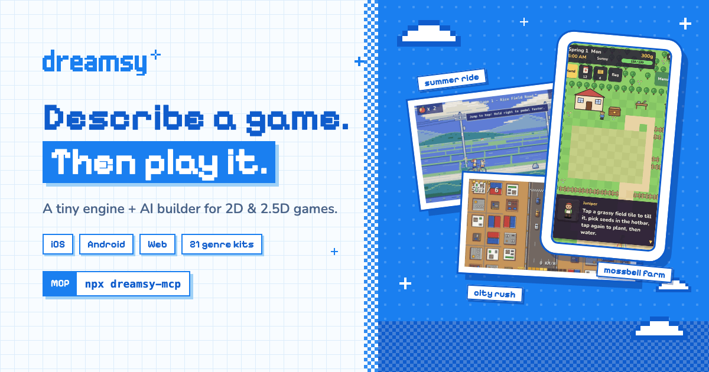
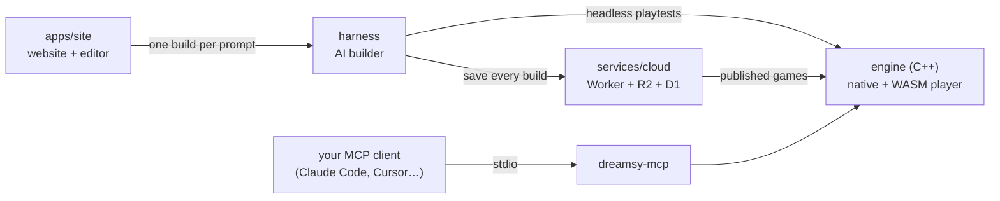

<p align="center">
  
</p>

<p align="center">
  <b>A tiny game engine and an AI builder for 2D &amp; 2.5D games.</b><br>
  Describe a game. Then play it, natively on iOS and Android, or in any browser.
</p>

<p align="center">
  <a href="https://dreamsy.dev"><b>dreamsy.dev</b></a> ·
  <a href="https://dreamsy.dev/editor">Editor</a> ·
  <a href="https://dreamsy.dev/library">Library</a> ·
  <a href="https://dreamsy.dev/play/macimf2uqk">Play Lanternkeeper</a> ·
  <a href="https://dreamsy.dev/docs">Docs</a>
</p>

<p align="center">
  <a href="#-quick-start">Quick start</a> ·
  <a href="#-make-games-three-ways">Three ways to make games</a> ·
  <a href="#-gallery">Gallery</a> ·
  <a href="#-how-it-works">How it works</a> ·
  <a href="DREAMSY.MD">Spec</a> ·
  <a href="#-license">License</a>
</p>

<p align="center">
  
  
  
  
  
  <a href="https://github.com/apoorvcodes/dreamsy/stargazers"></a>
</p>

---

## ✦ What is this?

Dreamsy is two things that fit together:

- **An engine.** A small C++20 core for 2D and 2.5D games (side, top-down, oblique and isometric). Games are written in
  sandboxed Luau, use Box2D physics, and ship as one `.dpk` file that is usually **30–220 KB**. The same file runs on a
  phone, in a browser (WebAssembly) and headless for automated playtests.
- **A builder.** An AI harness that turns a sentence into a playable game: it picks one of **21 genre kits**, writes the
  scenes and scripts, draws the sprites, composes chiptune music, then **plays the game itself** to catch errors before you
  ever see it. It runs on your own model key, or inside your own assistant over MCP.

```text
  you  ──▶ "a frog that hops between clouds collecting strawberries"
           │
           ▼
  route ─▶ kit: platformer ─▶ scenes + Luau ─▶ sprites ─▶ music ─▶ playtest ─▶ check
           │                                                                 │
           └──────────────────────────── frog.dpk (≈ 80 KB) ◀────────────────┘
```

## ✦ Quick start

Just want to make a game? Open **[dreamsy.dev/editor](https://dreamsy.dev/editor)**, or add
**`https://dreamsy.dev/mcp`** to ChatGPT or Claude as a custom connector. To build from source you need Node with pnpm,
CMake and a C++20 compiler.

```sh
git clone https://github.com/apoorvcodes/dreamsy && cd dreamsy
pnpm install

# the engine: dreamsy-tool (validate, pack, run, playtest)
(cd engine && cmake --preset release && cmake --build --preset release)

# optional: the web player, for in-browser previews and playtest screenshots (needs emsdk 4.0.11)
(cd engine && cmake --preset web && cmake --build --preset web --target dreamsy-player)
```

## ✦ Make games, three ways

### 1 · The editor

```sh
pnpm -C apps/site dev          # → http://127.0.0.1:3100/editor
```

Add your Anthropic or OpenAI key (kept in an httpOnly cookie, never written to disk), name a game and describe it.

| | |
|---|---|
| **Preview** | the game running in the engine's web player, right next to the chat |
| **Chat** | every build as a live timeline: plan, edits, sprites, music, playtest, art review, cost |
| **Sprites** | all the game's art; edit any SVG with a live preview, or ask Dreamsy to redraw it |
| **Music** | play every track and sound effect in the browser, with a piano-roll; ask for changes |
| **Files & versions** | browse the package; every build is a version you can play or restore |

Games are plain folders in `games/mine`, each with a banner captured from the game itself. Set `DREAMSY_CLOUD_URL` and
every build is also saved to the cloud.

### 2 · Your own assistant (MCP)

Hosted, for ChatGPT, Claude.ai and anything that takes a remote MCP URL (no sign-in; publish to get a play link):

```
https://dreamsy.dev/mcp
```

Local, for Claude Code, Cursor and other desktop clients (game folders stay on your computer):

```sh
claude mcp add dreamsy -- npx -y dreamsy-mcp
```

Then ask: *“build a cozy frog platformer with dreamsy”*. Your assistant's model does the building with the engine as its
tools (create from a kit, edit, draw sprites, write music, playtest, check, export). No Dreamsy key is involved.
Prebuilt for macOS (Apple Silicon) and Linux x64; from a clone, use `pnpm -s -C /path/to/dreamsy/harness mcp`.

### 3 · The command line

```sh
pnpm -C harness local --prompt "a pixel game where a frog collects coins" --out /tmp/frog [--rounds N]
pnpm -C harness local --prompt "make the frog faster" --base /tmp/frog --out /tmp/frog
engine/build/release/dreamsy-tool playtest /tmp/frog        # headless playtest report (JSON)
```

The CLI reads `ANTHROPIC_API_KEY` (optional `OPENAI_API_KEY`, `GEMINI_API_KEY`) from the repo-root `.env`.

## ✦ Gallery

Every frame below is a real screenshot from the engine.

<table>
  <tr>
    <td width="33%"><br><sub><b>Cloud Hopper</b> · 2.5D oblique platformer</sub></td>
    <td width="33%"><br><sub><b>Summer Ride</b> · side-scroller</sub></td>
    <td width="33%"><br><sub><b>City Rush</b> · top-down racer</sub></td>
  </tr>
  <tr>
    <td><br><sub><b>Mossling</b> · platformer kit</sub></td>
    <td><br><sub><b>Mossbell Farm</b> · farming kit</sub></td>
    <td><br><sub><b>Starfall Keepers</b> · rpg kit</sub></td>
  </tr>
  <tr>
    <td><br><sub><b>Tamsin of Wickhollow</b> · topdown kit</sub></td>
    <td><br><sub><b>Bramble Watch</b> · tower-defense kit</sub></td>
    <td><br><sub><b>Village Raiders</b> · base builder</sub></td>
  </tr>
</table>

## ✦ Kits

Kits are tested Luau libraries for whole genres. A game opts in with `kits = ["platformer"]` in `dreamsy.toml`, so the
basics (controls, levels, saves, menus, juice) already work.

| Genres | | | | |
|---|---|---|---|---|
| platformer | topdown | shooter | rpg | farming |
| puzzle | racing | runner | roguelite | deckbuilder |
| story | survival | simulator | tycoon | tower-defense |

**Foundations** (switched on automatically when a kit needs them): core · progression · juice · combat · ai · procgen.
Each kit has an example game in `games/examples/kit-*` and docs in `kits/<kit>/KIT.md`.

## ✦ How it works



Everything speaks one contract: the **game package** (`format/`, docs/format.md §3). It is a folder you can read by hand:

```text
my-game/
  dreamsy.toml          name, orientation, view, kits
  scenes/*.scene.json   entities and their components
  scripts/              Luau: client/ and shared/
  assets/               sprites (svg, png)
  data/                 kit content, data/music/*.json (chiptune), data/sfx/*.json (synth)
```

`dreamsy-tool pack my-game my-game.dpk` turns it into one content-addressed file. The harness writes packages, the engine
runs them, the cloud stores and publishes them.

**Inside a build:** a small model routes the request (new game, feature, tweak, art); the builder starts from the kit's
example, edits with validated ops (a batch applies only if the package stays valid), draws SVG sprites, asks a dedicated
composer for 3–5 music tracks (title, level, boss, victory and game-over jingles), runs headless playtests with
screenshots, and must pass a final gate (valid package, 8-second smoke run with no script errors) before an art-director
review. See [harness/DESIGN.md](harness/DESIGN.md).

## ✦ Repository

| Path | What |
|---|---|
| [`engine/`](engine/README.md) | The C++20 engine: one core for web (WASM), iOS, Android and headless tools (`dreamsy-tool`). |
| [`format/`](format/LUAU_API.md) | `@dreamsy/format`: package schemas, entity catalog, validator, edit ops. `LUAU_API.md` is the scripting contract. |
| `kits/` | The 21 kits: Luau libraries, docs, content schemas. |
| [`harness/`](harness/DESIGN.md) | The AI builder, the MCP server and the CLI. |
| [`apps/site/`](apps/site/README.md) | The website (landing, library, kits, docs) and the editor at `/editor`. Next.js. |
| [`services/cloud/`](services/cloud/README.md) | Cloudflare Worker: save games without accounts, publish them, remix them. |
| [`packages/mcp/`](packages/mcp/README.md) | The `dreamsy-mcp` npm package: the MCP server plus a prebuilt engine per platform. |
| `games/` | `examples/` (one golden game per kit), `showcase/` (generated games), `mine/` (yours, gitignored). |
| `taste/` | House-style packs and reference images for art direction. |
| `docs/` | The spec by topic, indexed from [DREAMSY.MD](DREAMSY.MD), and a C++ guide for TypeScript developers. |
| `third_party/` | Vendored libraries (Luau, Box2D, sokol, miniaudio…). Don't modify. |

The earlier hosted platform (`services/api`, `services/gameserver`, `apps/web`, `apps/mobile`, `deploy/`,
`scripts/dev.sh`) is still here but not deployed: an Expo app and web studio on an API that queued builds for harness
workers, plus a multiplayer room server. `./scripts/dev.sh` still runs it locally.

## ✦ Environment

Real env files are gitignored; only `.env.example` templates are committed.

| Where | Variable | What |
|---|---|---|
| `apps/site` | `DREAMSY_GAMES_DIR` | Where editor games live (default `games/mine`). |
| `apps/site` | `DREAMSY_CLOUD_URL` | The deployed `services/cloud` Worker; every build is also saved there. |
| `apps/site` | `SITE_URL` | Public URL for canonical links, Open Graph images, `robots.txt` and the sitemap. |
| repo-root `.env` | `ANTHROPIC_API_KEY`, `OPENAI_API_KEY`, `GEMINI_API_KEY` | Keys for the harness CLI. The editor uses each user's own keys. |
| `services/cloud/wrangler.toml` | `ALLOWED_ORIGINS` | Site origins allowed to call the Worker from a browser. |

## ✦ Handy commands

```sh
pnpm test                                   # every package's tests
pnpm typecheck                              # every package's typecheck

pnpm -C format cli validate /tmp/frog       # validate a game package
pnpm -C format catalog                      # regenerate format/catalog.json
pnpm -C apps/site brand                     # regenerate the OG image and app icons from the logo
pnpm -C packages/mcp pack:all               # build and pack dreamsy-mcp and its engine packages

pnpm -C services/cloud test                 # Worker tests on local R2 + D1 (Miniflare)
pnpm -C services/cloud migrate:remote       # apply D1 migrations
pnpm -C services/cloud deploy               # deploy the Worker (wrangler login first)
```

Engine builds, tests and conformance checks: [engine/README.md](engine/README.md).

## ✦ House rules

- The game package format is the central contract. Don't change `format/` without updating docs/format.md §3.
- 2D and 2.5D only; the format keeps 3D types, but the engine rejects 3D packages.
- `third_party/` is vendored; don't modify it.
- Each package has its own README with the details.

## ✦ Contributing

Bug reports, kits, example games and fixes are welcome: see [CONTRIBUTING.md](CONTRIBUTING.md), the
[Code of Conduct](CODE_OF_CONDUCT.md) and [SECURITY.md](SECURITY.md) for reporting vulnerabilities. Changes are listed
in [CHANGELOG.md](CHANGELOG.md).

## ✦ License

Dreamsy's own code is under the [PolyForm Noncommercial License 1.0.0](LICENSE): free to use, change and share for
personal, hobby, research, educational and nonprofit purposes; **commercial use is not permitted**. Libraries vendored in
`third_party/` keep their own licenses.

<p align="center"><sub>made with tiny pixels ✦ dreamsy</sub></p>
